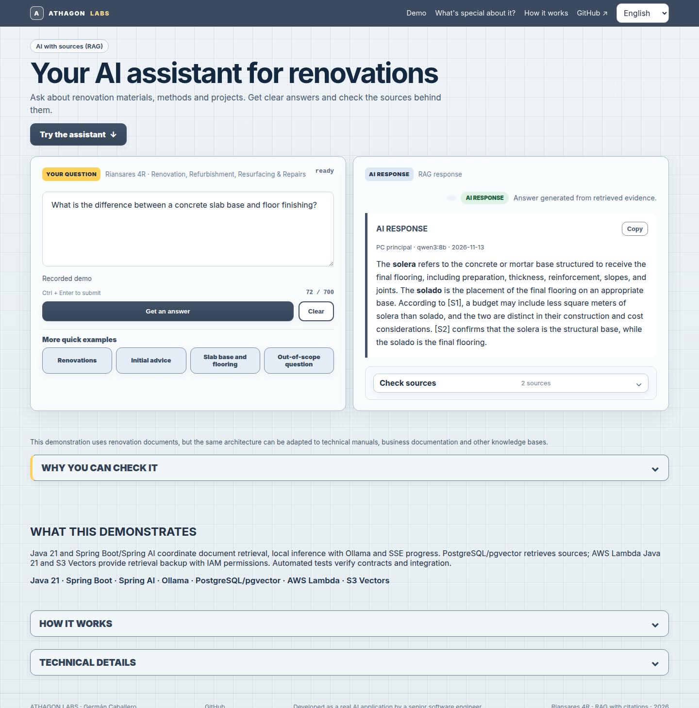
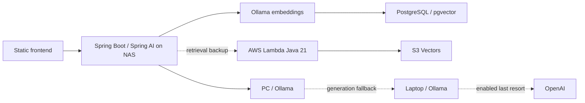

# R4R — AI assistant for renovation questions

A deployed bilingual assistant that answers questions about renovation materials,
methods and projects using Riansares 4R documents, with PDF citations visitors can
check. The public frontend is static HTML/CSS/JavaScript in
`front-athagon-r4r-static/`; `frontend/` contains the separate Angular application.



## How it works



Java 21 and Spring AI coordinate retrieval and generation; SSE exposes actual
processing stages. IAM constrains the Lambda/S3 Vectors path. AWS retrieval backup
does not replace the NAS API. This release does not claim Bedrock/Titan is operational,
zero downtime or large-scale availability.

## Visitor experience and trade-offs

- Visibility triggers the recorded kitchen walkthrough once per page load.
  The three cumulative kitchen questions replay the six user-supplied real ES/EN results without API calls.
- The CTA, four quick examples and arbitrary questions all use live SSE. Exact verified CTA/example recordings are a clearly labelled fallback only after network failure, timeout or 5xx; arbitrary submissions and 429 never silently become recordings. Translation is delegated to the existing
  backend; the browser no longer contacts MyMemory.
- Citations preserve their original source trace while opening the verified language counterpart from a 41-ID bilingual PDF catalogue. The original eight PDFs remain available alongside 82 branded ES/EN PDFs covering the reorganized corpus. Internal
  ordinals are restricted to `?dev=1`, alongside endpoint controls.
- Runtime is queried on opening Technical details, keeping the initial preview
  completely offline. Per-answer provider/model comes from that request's events;
  global runtime information is separate.

## Run and validate

```bash
python3 -m http.server 8765 --directory front-athagon-r4r-static
node front-athagon-r4r-static/js/app.test.cjs
# Requires an existing Playwright installation and Chromium:
node front-athagon-r4r-static/js/browser.test.cjs
node front-athagon-r4r-static/js/interaction.test.cjs
mvn clean verify
```

For an existing external installation set `PLAYWRIGHT_MODULE` and `CHROMIUM_PATH`.
No new frontend dependency is required. The static site needs no build step.
The existing Maven test configuration controls optional database/cloud/live-model
gates; unit and browser regression tests do not require an LLM. Regenerate the
branded knowledge PDFs with `python3 py-scripts/export_sources.py`.

## Deployment and evidence

Copy `index.html`, `js/`, `styles/`, `assets/` and `docs/` from the static frontend
into the hosting repository's `html-static/r4r-rag/`; keep `r4r-rag-demo/` intact.
Do not publish test scripts as application assets. The site retains `noindex`.
No deployment or push is part of this release.

[Latest PDF evidence correction](docs/validation/pdf-evidence-2026-11-13/README.md)
record the live ES/EN results, browser checks, accessibility measurements and limits.
Domestic NAS, network and tunnel dependencies remain. Captured examples improve
predictability but cannot establish general model accuracy. Three-user comprehension
acceptance remains a manual task.

## Existing operational notes

# R4R worktree branch synchronization v3

Files:

- `AGENTS.md`: restores the 45–70 minute target, 90 minute hard ceiling and one-gate/one-commit subtask policy for PC, LP and Ring.
- `scripts/sync-agent-branches.sh`: no-argument full worktree-aware fetch, sequential centralization, round propagation and pushes.
- `scripts/install-r4r-branch-sync-systemd.sh`: installs the 3-minute user timer and invokes the sync script without flags.

Default sync discovery uses `git worktree list --porcelain` from the shared Git common directory. Every non-detached worktree branch participates except the hub branch itself. Use `--exclude PATTERN` for an explicit opt-out.

PC and LP are converged once at the end through the existing safe worker merger to avoid restarting active workers once per source branch. Other subscribed worktrees are propagated after every source round.

## Live agent consoles

Open each block in a separate terminal. Press `Ctrl+C` to stop following a log.

### Ring Agent

```bash
cd ~/Desarrollo/r4r-ring-agent.git

tail -n 200 -F \
  runtime/ring-system/ring-agent.console.log
```

### PC backend agent

```bash
cd ~/Desarrollo/r4r-ring-agent.git

PC_LOG="$(
  {
    find runtime/ring-agent/pc \
      -type f -name '*.log' -printf '%T@ %p\n' 2>/dev/null
    find runtime/ring-agent/bootstrap \
      -type f -name '*-PC.log' -printf '%T@ %p\n' 2>/dev/null
  } |
  sort -nr |
  cut -d' ' -f2- |
  head -n 1
)"

test -n "$PC_LOG" || {
  echo 'No PC agent console log found.' >&2
  exit 1
}

printf 'Following PC console: %s\n' "$PC_LOG"
tail -n 200 -F "$PC_LOG"
```

### LP frontend agent

```bash
cd ~/Desarrollo/r4r-ring-agent.git

LP_LOG="$(
  {
    find runtime/ring-agent/lp \
      -type f -name '*.log' -printf '%T@ %p\n' 2>/dev/null
    find runtime/ring-agent/bootstrap \
      -type f -name '*-LP.log' -printf '%T@ %p\n' 2>/dev/null
  } |
  sort -nr |
  cut -d' ' -f2- |
  head -n 1
)"

test -n "$LP_LOG" || {
  echo 'No LP agent console log found.' >&2
  exit 1
}

printf 'Following LP console: %s\n' "$LP_LOG"
tail -n 200 -F "$LP_LOG"
```

## Benchmark RAG y proveedores

El build Maven es offline por defecto: `mvn test` ejecuta la batería obligatoria,
`mvn clean package` genera el JAR y `mvn clean verify` añade HTTP/SSE/failover simulado.
PostgreSQL, AWS y LLM reales se seleccionan con `-Ppostgres-it`, `-Paws-it` y
`-Pllm-it`. Requisitos, clasificación y comandos completos: [pruebas Maven](docs/testing.md).

La [comparativa A–F](docs/benchmarks/rag-providers/README.md) identificó F (embeddings en portátil y generación en PC) como la más rápida: **8/8 PASS, 2,73 s de media E2E SSE**. La [validación final con preguntas ajustadas al corpus](docs/benchmarks/rag-providers/final-validation.md) obtuvo **30/30 PASS**. La configuración operativa permanece intacta; los informes explican cómo seleccionar F sin modificar credenciales ni desplegar.


### Configuración pública y privada del RAG

Los valores operativos están en [`docker-spring/.env.base`](docker-spring/.env.base),
versionado. `docker-spring/.env` permanece privado e ignorado: solo secretos y
sobrescrituras, con prioridad sobre la base. Sustituye al antiguo `.env.example`.
Las listas `RAG_GENERATION_PROVIDERS`, `RAG_EMBEDDING_PROVIDERS` y
`RAG_CORS_ALLOWED_ORIGINS` son las fuentes públicas de proveedores y orígenes.
S3 Vectors y Luna conservan sus flags independientes, deshabilitados por defecto.
Compose 2.20.3+ mantiene el comando habitual de arranque; no hace falta exportar
variables manualmente. Véase [configuración y migración manual](docs/operations/public-private-configuration.md).

El [failover de lectura PostgreSQL → S3 Vectors](docs/operations/vector-store-failover.md)
se activa explícitamente y permite arranque degradado y recuperación automática de
PostgreSQL; el perfil `s3-readonly` mantiene la recuperación manual sin PostgreSQL
y bloquea escrituras sin desactivar las migraciones del arranque normal.

La [integración AWS por variables de entorno](docs/operations/s3-vectors-environment.md)
documenta la inyección exclusiva al contenedor API, las pruebas aisladas y los pasos
manuales de IAM, índice y Synology pendientes antes de habilitar el respaldo S3.
