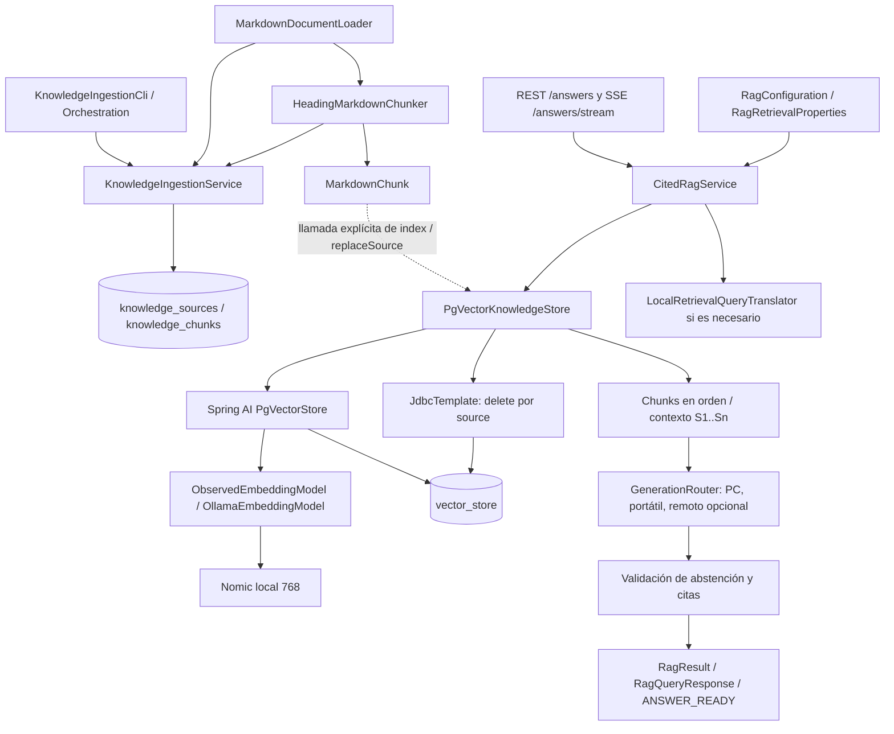

# R4R — Plan de arquitectura modular pgvector + Amazon S3 Vectors + failover

Fecha de investigación: **7 de noviembre de 2026**. Actualización: fase 2 autorizada e integrada sobre **a2f39bee79a78ab9e129ec581fc9721830ec2c01**. Estado: **fase 2 implementada, validación parcial por configuración de test ausente y fallos previos del gate histórico; fase 3 adaptador de lectura implementado y probado con mocks, pendiente de importación/verificación AWS; fase 4 a cargo de otro agente**. Las observaciones de fase 1 se conservan como históricas donde se indica.

Convenciones de evidencia utilizadas en todo el documento:

- **[CÓDIGO]**: comprobado por lectura del worktree AWS y, cuando se indica, fuentes locales de Spring AI 1.0.0. No significa ejecutado ni desplegado.
- **[DOC]**: comprobado en documentación versionada o documentación oficial externa consultada; sus resultados históricos no son resultados de esta sesión.
- **[PENDIENTE]**: no comprobado, necesita evidencia posterior o autorización.
- **[DISEÑO]**: propuesta para implementar después; no describe funcionalidad existente.

## 1. Objetivo y alcance

Desacoplar el RAG de PostgreSQL mediante un puerto Java, conservar primero el comportamiento pgvector y añadir después un adaptador Amazon S3 Vectors y failover de lectura por fallos técnicos recuperables. Arquitectura elegida por el usuario: **monolito modular en el Maven actual**, sin microservicios, conversión global a Maven multimódulo ni movimientos masivos.

La fase 1 autorizó investigar y crear exclusivamente este archivo. Durante fase 1 no se modificaron Java, POM, tests, frontend, configuración, instrucciones ni el worktree principal y no se ejecutó producto. Fase 2 autoriza ahora la extracción Java, sus tests, el gate revisado y la actualización de este mismo documento. POM, Flyway V1–V3, frontend, corpus, prompts, benchmarks, AGENTS y DEVELOPMENT permanecen fuera de las escrituras de fase 2. No se realizarán llamadas AWS ni transferencias de corpus. Tampoco se han leído archivos `.env` o credenciales. Las consultas web son a documentación pública.

No se declara aceptada ninguna implementación futura ni se certifica el RAG desplegado. **La autorización `CONTINÚA FASE 2` ya se recibió**, junto con la excepción expresa al flujo OpenCode y la confirmación de integración manual final. Esa frase no autoriza por sí sola las fases 3/4, envío de corpus, creación de infraestructura ni despliegues.

## 2. Estado Git y versión examinada

**[CÓDIGO / Git, comprobación de fase 2]**: directorio real AWS correcto, rama `feature/aws-s3-failover`; HEAD, `refs/heads/main` y merge-base iguales a **`a2f39bee79a78ab9e129ec581fc9721830ec2c01`**. Sin entradas en `git ls-files -u`, sin staged/unstaged de producto. Único pendiente inicial: este plan **untracked**, creado por esta sesión en fase 1 y preservado por el usuario. No hay modificaciones de otro propietario en AWS que descartar.

El usuario confirmó finalización del agente y realizó personalmente la integración. El commit está presente y contiene `fix(rag): Restore bilingual retrieval and align live tests with the corpus`, con documentación de validación y proveedores. Se verificaron los cambios respecto a `3e5e492` y se releyeron las clases finales: expansión de encabezados en PG, referencias FAQ validadas, prompt final de evidencia, traductor, interceptor thinking y configuración Top-K **5**, score **0,63**, timeout de traducción **30 s**. No se modificará ninguna de esas decisiones funcionales. Los resultados live finales se conservan en `docs/benchmarks/rag-providers/final-validation.md`; se distinguen de pruebas nuevas de este refactor.

Los dos worktrees comparten repositorio/refs, con índices y archivos de trabajo separados. No se hizo merge, checkout, rebase, reset, add, commit ni push en este repositorio. Toda escritura Git queda en manos del usuario.

### Observación histórica de fase 1 (superada por la integración anterior)

**[CÓDIGO / Git, observación inicial, no sondeo continuo]**:

| Comprobación | Resultado |
| --- | --- |
| `pwd -P` | `/home/german/Desarrollo/R4R/r4r-spring-ai-rag-aws-s3.git` |
| Rama activa | `feature/aws-s3-failover` |
| HEAD AWS | `3e5e49221120ff683087c93d1bd55061f8c4094f` |
| `refs/heads/main` | `3e5e49221120ff683087c93d1bd55061f8c4094f` |
| Diferencia inicial de commits feature/main | `0 / 0` |
| Último commit | `2026-11-07T16:26:18+01:00`, `docs(benchmarks): record provider inventory and pending RAG validation. Document existing IT cases and missing read-only database access.` |
| AWS staged / unstaged / untracked inicial | Ninguno; `git status --short`, ambos `diff --stat` y ambos `diff --check` sin salida |
| Worktree principal | `/home/german/Desarrollo/R4R/r4r-spring-ai-rag.git`, rama `main` |
| Directorio Git común | `/home/german/Desarrollo/R4R/r4r-spring-ai-rag.git/.git` |

`git worktree list --porcelain` confirma dos worktrees del mismo repositorio: comparten objetos y referencias, pero tienen directorios de trabajo e índices separados. El sufijo `.git` del directorio AWS no significa que sea un repositorio bare. Leer `refs/heads/main` desde AWS permite conocer su HEAD sin modificar el otro árbol.

Una única lectura de `git -C <principal> status --short` mostró **modificaciones unstaged** en:

```text
README.md
docs/benchmarks/rag-providers/README.md
docs/benchmarks/rag-providers/embed-laptop_llm-laptop.md
docs/benchmarks/rag-providers/embed-pc_llm-laptop.md
docs/benchmarks/rag-providers/embed-pc_llm-pc.md
docs/benchmarks/rag-providers/embed-synology_llm-laptop.md
docs/benchmarks/rag-providers/embed-synology_llm-pc.md
docs/benchmarks/rag-providers/final-validation.md
src/main/java/com/riansares/r4r/rag/CitedRagService.java
src/main/java/com/riansares/r4r/rag/RagConfiguration.java
src/main/java/com/riansares/r4r/vector/PgVectorKnowledgeStore.java
src/main/resources/application.yml
src/test/java/com/riansares/r4r/llm_tests/RagLiveEnglishQuestionsIT.java
src/test/java/com/riansares/r4r/llm_tests/RagLiveQuestionsIT.java
src/test/java/com/riansares/r4r/rag/CitedRagServiceInvalidAnswersTest.java
```

Y archivos nuevos sin seguimiento:

```text
docs/benchmarks/rag-providers/prompt-before-citation-fix.md
src/test/java/com/riansares/r4r/vector/PgVectorSectionContextTest.java
```

No aparecieron entradas staged en esa observación. No se han leído ni copiado los contenidos intermedios de esos cambios. **[PENDIENTE]** El HEAD final de main, el resultado definitivo de sus pruebas y posibles nuevos métodos del almacén aún se desconocen. Los inventarios originales describen la base de fase 1; los cambios verificados de fase 2 se identifican expresamente. No se ha esperado al otro agente ni integrado nada.

## 3. Instrucciones vigentes y conflictos detectados

**[DOC]** Se han leído íntegramente `AGENTS.md`, `DEVELOPMENT.md`, `pom.xml`, `src/main/resources/application.yml`, `docs/architecture.md`, `docs/dual-agent-code-intelligence.md` y `codegraph.json`; además, los ocho documentos de `docs/rag/`, `docs/operations/` y `docs/validation/` inventariados en la sección 5.

### Resolución expresa para fase 2

**[AUTORIZACIÓN DEL USUARIO]** Se permite esta sesión Codex independiente sin OpenCode/Ring/asignaciones/controlador. No requiere modificar AGENTS: el apartado propuesto abajo queda como propuesta histórica **NO aplicada ni necesaria para esta ejecución**. AGENTS y DEVELOPMENT no se modifican. El usuario realiza personalmente todos los merges y commits; Codex solo usa Git de lectura. Esta excepción limitada no altera agentes históricos ni salvaguardas de datos/producción. El plan y los archivos de refactor/tests/gate descritos en sección 18 constituyen el alcance aprobado, sin añadir campos de scope a Ring.

### Conflictos originales con el flujo Codex independiente

| Regla vigente | Conflicto y resolución para este encargo |
| --- | --- |
| AGENTS: “All model sessions run through OpenCode” | Esta sesión es Codex independiente. La petición explícita del usuario autoriza esta investigación y el único documento; no convierte Codex en PC/LP ni modifica la ejecución productiva histórica. Formalizar la excepción antes de implementar. |
| Única fuente `.opencode/task-plan.json`; asignación fresca, `allowed_paths`, gate y aceptación por controlador | No se recibió asignación Ring. No inventar una ni escanear tareas para obtener trabajo. Esta fase tiene alcance explícito del usuario: solo este documento; no simular aceptación del controlador. |
| Prohibición de `git add`, `commit`, `reset`, `checkout`, `merge`, `push` desde modelo | Sigue vigente; no se ejecutó ninguno. La integración futura debe realizarla el usuario/controlador o requerir excepción específica adicional. |
| DEVELOPMENT: “Mantener este archivo como memoria de desarrollo; no crear otro Markdown paralelo” | Este entregable es un plan solicitado expresamente, no una nueva memoria. La autorización concreta permite el archivo nombrado sin editar DEVELOPMENT ni crear evidencia adicional. |
| Cambios arquitectónicos, proveedores, costes y operación requieren aprobación | Las fases posteriores están diseñadas, no autorizadas ahora. Ningún nombre AWS constituye permiso de provisionamiento. |
| Modelo de aceptación Ring: gate exacto y resultado registrado por controlador | Para Codex independiente hace falta un criterio de aceptación explícito del usuario; los gates históricos se conservan para sus agentes. |

También siguen vigentes Java 21, Spring AI, Flyway como dueño del esquema, referencias/grafos de solo lectura, exclusiones de rutas pesadas y ausencia de LLM real en unitarios/Playwright. Los modelos/perfiles RING/PC/LP/ESCALATION no autorizan ni requieren lanzar agentes en este encargo. No se ha delegado trabajo.

### Modificación mínima propuesta de AGENTS.md — NO aplicada

Añadir un único apartado delimitado, sin reescribir las reglas Ring/PC/LP:

```markdown
## Explicit independent Codex work in the AWS worktree

Only in /home/german/Desarrollo/R4R/r4r-spring-ai-rag-aws-s3.git,
on feature/aws-s3-failover, an independent Codex session may perform
the phase explicitly authorized by the user under
docs/R4R-AWS-S3-VECTORS-FAILOVER-PLAN.md. For this workflow only,
the user's explicit task and write scope replace Ring assignment,
OpenCode-only session execution and controller acceptance requirements.
The authorized scope must be recorded in the existing plan before editing;
it is not a second allowed_paths field for Ring workers.
Phase 1 permits only the named planning document. Each later phase
requires separate authorization and its agreed validation gates.
Git history and integration operations remain owned by the user or
deterministic controller; model sessions retain all existing Git bans.
Product, credential, production and read-only-reference safeguards remain.
No authorization here permits AWS provisioning, real corpus transfer,
deployment or writes in the main worktree. All Ring/PC/LP/ESCALATION
instructions and production OpenCode-only controller rules are unchanged.
```

La excepción explícita recibida para fase 2 resuelve este punto sin aplicar el apartado propuesto. No permite importar/invocar Codex desde scripts productivos. Si se desean merges ejecutados por el modelo, hará falta otra autorización que nombre operación, rama y SHA; **este plan recomienda que Git siga en manos del usuario**.

### Ajustes verificados tras main final

`PgVectorKnowledgeStore.search()` ahora expande chunks que solo contienen un heading: lee hasta tres descendientes de la misma fuente y path mediante SQL existente, ordenados por ordinal, con límite de contexto de 6.000 caracteres. Esa lógica permanece privada al adaptador, sin método público adicional. `PgVectorSectionContextTest` verifica la expansión sin otro embedding. `CitedRagService` añade validación de referencias FAQ y conserva el prompt final de main íntegro. El puerto de tres métodos cubre todas las llamadas actuales. El valor vigente de configuración es Top-K 5, no el 3 observado en fase 1.

### Vigencia documental

- **[CÓDIGO+DOC]** `docs/architecture.md` coincide con la estructura actual del producto y mantiene el sistema OpenCode como arquitectura de agentes vigente; el antiguo controlador Codex archivado no es runtime.
- **[DOC]** `docs/dual-agent-code-intelligence.md` contiene instrucciones anteriores de dos agentes en la misma rama, commit manual e indexación de referencias `.r4r/`. No prevalece sobre las reglas actuales de aislamiento/controlador de AGENTS ni se ejecuta aquí.
- **[DOC]** `docs/rag/diagnostico-recuperacion-ingles.md` (29/10) conserva resultados históricos con Top-K 5 y 0,64. El código examinado usa **5 y 0,63** tras main final (3 en fase 1). Sus scripts de probes no se ejecutaron.
- **[DOC]** `docs/validation/r4r-mvp-task5.md` documentó retirada de MyMemory; `r4r-mymemory-restoration.md` y DEVELOPMENT registran su restauración posterior. No volver al flujo histórico por copiar ese informe.
- **[DOC]** La restauración informó siete fallos live ES/EN y una regresión de equivalencia con MyMemory. No están revalidados aquí ni se declaran solucionados; el agente en main trabaja sobre validación posterior.
- **[CÓDIGO vs DOC]** `REVISION.md` es una auditoría anterior a SSE, citas obligatorias y tercer proveedor. El código actual ya rechaza respuestas sin citas y usa proveedor por petición. `openai-fallback.md` describe traducción solo local y lectura remota 45 s, mientras esta base configura traducción con remoto opcional y límites por defecto 35 s/remoto y 20 llamadas/día. Conservar el código final de main y reconciliar documentación después; no corregir esa diferencia dentro de fase 1/2.
- **[CÓDIGO+DOC]** `rag-sse.md` y `model-warmup.md` son referencias útiles para ciclo de vida, cancelación, instrumentación y APIs; sus recuentos de pruebas son históricos. `docker-postgres/README.md` identifica como Compose vigente el de `docker-spring/`; los textos de bootstrap de `docker-postgres/init/` no acreditan un montaje operativo actual.

## 4. Estado de CodeGraph y herramientas utilizadas

**[CÓDIGO / herramientas]** Búsqueda en las herramientas disponibles de esta sesión: ningún MCP CodeGraph ni Code-Graph-RAG. No se ha supuesto conexión por existir configuración de OpenCode.

CLI localizada en `/home/german/.nvm/versions/node/v22.23.1/bin/codegraph`, versión **1.5.0**. Node efectivo `/usr/bin/node`, **v24.22.2**; npm `/usr/bin/npm`. Se ejecutaron únicamente `codegraph --help`, `--version`, `status --help`, `query --help`, `serve --help` y `codegraph status .`. Resultado exacto relevante: **“Not initialized”**, proyecto AWS correcto. No existe `.codegraph/` en este árbol.

La ayuda anuncia `query`, `explore`, `node`, `callers`, `callees`, `impact`, `affected`, `files` y `status`; `serve --mcp` sigue admitido, con `--path` y `--no-watch`. Sin índice local no hay consultas útiles de símbolos. No se ejecutaron `init`, `index`, `sync`, instalación, upgrade, daemon ni servidor. Crear un índice escribiría fuera del único archivo permitido y `codegraph.json` incluye referencias ignoradas `.r4r/`; no se justifica esa generación para este análisis.

Configuración comprobada:

- Wrapper real: `scripts-ai/codegraph-mcp.sh`; calcula su raíz, hace `cd` allí y ejecuta `${R4R_CODEGRAPH_BIN:-codegraph} serve --mcp`.
- `opencode.jsonc`: `mcp.codegraph.enabled=false`; permisos `codegraph_*` y `code_graph_rag_*` en `deny`; ruta `./scripts/codegraph-mcp.sh` **inexistente**. `./scripts/cgr.sh` también difiere de `scripts-ai/cgr.sh`.
- `config/r4r-agents.json`: intención `codeIntelligence.codeGraph.enabled=true` y `codeGraphRag.enabled=true`. Es configuración del sistema histórico, no evidencia de conexión efectiva; contradice el archivo estático de OpenCode. No se inició su runtime para resolverla.
- `package.json` y el indexador también conservan rutas `scripts/` para utilidades presentes en `scripts-ai/`. No se ejecutó `npm run code:index` ni se clonaron referencias.
- `codegraph.json` excluye target/node_modules/dist/runtime/datos/índices, pero incluye `.r4r/reference-repositories/`. No usarlo sin acotar explícitamente el worktree y resolver exclusiones si se autoriza una indexación futura.

**Conclusión:** CLI disponible; CodeGraph **no utilizable como grafo en esta sesión por ausencia de índice y MCP**, no por un fallo demostrado del motor. Alternativa usada: `rg` acotado, lectura Java/SQL/YAML/Markdown, Git solo lectura y lectura sin extracción a disco del JAR de fuentes local de Spring AI. Sin búsquedas recursivas en rutas prohibidas. Para AWS se consultaron fuentes oficiales enlazadas en las secciones siguientes.

## 5. Inventario de clases y archivos relevantes

Todas las rutas Java siguientes parten de `src/main/java/com/riansares/r4r/`. **[CÓDIGO]** Nombres comprobados en esta base:

| Ruta | Responsabilidad y acoplamiento |
| --- | --- |
| `document/MarkdownDocumentLoader.java`, `KnowledgeDocument.java` | Lee Markdown, ordena rutas relativas normalizadas y valida tamaño. |
| `chunking/HeadingMarkdownChunker.java`, `MarkdownChunk.java` | Secciones por headings, fragmentos acotados; record `(source, headingPath, index, content)`, sin score ni vector. |
| `cli/CatalogConfiguration.java`, `service/KnowledgeCatalogService.java` | Beans de loader/chunker/catálogo; catálogo opcional al arranque, no indexación vectorial. |
| `ingestion/KnowledgeIngestionService.java` | JDBC, checksum y transacción de sources/chunks; sin `VectorStore` ni llamada al almacén vectorial. |
| `ingestion/KnowledgeIngestionOrchestration.java`, `KnowledgeIngestionCli.java`, `IngestionConfiguration.java` | Configuración, raíz canónica, resultado JSON y códigos de salida 0–5; arranca contexto Spring no web. Clasificación infra amplia para ingesta, no apta para copiar al failover vectorial. |
| `vector/pgvector/PgVectorKnowledgeStore.java` (movido en fase 2) | Bean explícito en configuración; `index`, `replaceSource` transaccionales; `search` mediante Spring AI y borrado por source mediante JDBC. |
| `config/OllamaEmbeddingConfiguration.java` | Bean exclusivo `OllamaEmbeddingModel`, URL de embeddings independiente, cliente Spring AI con timeouts. |
| `rag/ObservedEmbeddingModel.java` | Subclase del modelo Ollama; observa una llamada a Spring AI conservando tipo de bean/autoconfiguración. |
| `rag/CitedRagService.java` | Tras fase 2 depende de `KnowledgeVectorStore`; búsqueda, contexto, prompt, generación y validación de abstención/citas. |
| `rag/RagConfiguration.java`, `config/RagRetrievalProperties.java` | Tras fase 2 inyecta el puerto común, Top-K/score, router de generación y traductor. |
| `rag/GenerationRouter.java`, `LocalRetrievalQueryTranslator.java`, `OpenAiResponsesModel.java` | Failover de **generación** existente y traducción auxiliar; fuera del cambio de proveedor vectorial. |
| `rag/RagProgress.java` | Eventos por petición, cancelación y métricas; scope ThreadLocal solo para embeddings durante recuperación síncrona. |
| `rag/RagResult.java`, `Citation.java` | Resultado utilizado por servicio/API; citas con label/source/headingPath/ordinal. `CitedRagResult.java` también existe pero no es el retorno del servicio actual. |
| `rag/api/RagQueryController.java`, `RagQueryRequest.java`, `RagQueryResponse.java` | POST REST, pregunta/recuperación/idioma, contrato JSON y proveedor de generación por petición. |
| `rag/api/RagStreamController.java` | POST SSE, `SseEmitter`, cuatro streams, cálculo/escritores acotados, heartbeat, cancelación y error saneado. |
| `rag/api/RagRuntimeController.java`, `rag/OllamaModelPreloader.java` | GET runtime/POST warmup, observaciones y precarga; no confundir proveedor/modelo con almacén vectorial. |
| `config/RagApiSecurityFilter.java`, `WebConfiguration.java` | Orígenes, cuotas REST/SSE, normalización de rutas y CORS; conservar. |

Configuración/esquema y pruebas examinadas:

- `pom.xml`: Java **21**, Spring Boot **3.4.5**, Spring AI **1.0.0**, versión de producto **0.3.2**. Starters web/JDBC/Ollama/pgvector; Flyway PostgreSQL. No SDK S3 Vectors en el POM actual.
- `src/main/resources/db/migration/V1__postgres_pgvector_baseline.sql`, `V2__knowledge_ingestion.sql`, `V3__pgvector_store.sql`.
- `src/main/resources/application.yml`, `src/test/resources/application-test.yml`, `application.properties` y `META-INF/spring.factories`.
- `src/test/java/com/riansares/r4r/vector/`: `PgVectorKnowledgeStoreIT`, `PgVectorKnowledgeStoreTransactionalRollbackIT`, `PgVectorTestConfiguration`, `DeterministicEmbeddingModel` (768 dimensiones).
- Ingesta: `KnowledgeIngestionServiceTest/IT`, `KnowledgeIngestionCliTest`, `KnowledgeIngestionCliContractTest`, `KnowledgeIngestionSpringLifecycleTest`, `KnowledgeIngestionFailureClassificationTest`, `KnowledgeIngestionCliProcessIT`.
- RAG: `CitedRagServiceTest`, `CitedRagServiceCitationsTest`, `CitedRagServiceInvalidAnswersTest`, `CitedRagMultilingualRetrievalTest`, `RagStreamingTest`, `GenerationRouterTest`, `LocalRetrievalQueryTranslatorTest`, `OpenAiFallbackTest`.
- APIs/seguridad: `RagQueryControllerTest`, `RagStreamControllerTest`, `RagStreamHttpIT`, `RagRuntimeControllerTest`, `RagApiCorsTest`, `RagApiSecurityFilterTest`, `OllamaServerSeparationTest`.
- DB: `PostgresBaselineIT`, `DatabaseEnvironmentTest`, `TestDatabaseGuard`. Guard exige URL exacta de test `jdbc:postgresql://192.168.1.203:5433/r4r_rag_test` y usuario `r4r_test`; valida antes de crear beans.
- Live opt-in: `llm_tests/RagLiveQuestionsIT`, `RagLiveEnglishQuestionsIT`, `LunaLiveIT`, y `rag/OllamaEmbeddingWarmupLiveIT`; no ejecutados aquí.
- Docker: `docker-spring/Dockerfile` Java 21; `docker-spring/docker-compose.yml`: PostgreSQL/pgvector 16, base de test independiente, Ollama embeddings, API y cloudflared. API depende de salud de PostgreSQL y Ollama. No se ejecutó Compose: su interpolación/importación `.env` no es necesaria para el plan.
- Gates: `scripts/task-gate.sh`, `scripts/verify.sh`. El primero se ha actualizado a las rutas movidas del adaptador/test; el fallo Python del baseline sigue pendiente fuera del alcance. `verify.sh all` ejecuta pruebas Python del controlador y `mvn verify`, con escrituras generadas y a DB de test: no es un gate de documentación seguro para fase 1.
- Maven Surefire configura perfil `test` para unitarios; Failsafe **3.5.3**, `integration-test` + `verify`, ejecuta los `*IT`. Varias integraciones truncan tablas/crean triggers y Flyway: reservarlas a la base de test autorizada, jamás a producción.

Documentos leídos de los directorios solicitados: `docs/rag/diagnostico-recuperacion-ingles.md`; `docs/operations/REVISION.md`, `model-warmup.md`, `ollama-server-separation.md`, `openai-fallback.md`, `rag-sse.md`; `docs/validation/r4r-mvp-task5.md`, `r4r-mymemory-restoration.md`. Los benchmarks nuevos de main son trabajo en curso, no baseline final.

## 6. Mapa de dependencias y flujo RAG actual

**[CÓDIGO]** Dependencias directas (flecha) e indirectas (encadenamiento):



La línea discontinua **no representa un pipeline productivo automático verificado**. En `src/main/java` no hay invocador de `index()`/`replaceSource()` del componente vectorial; sus llamadas verificadas están en tests. El catálogo y la CLI SQL no rellenan `vector_store`. Falta identificar tras main el proceso operativo que cargó el corpus vectorial; no inventarlo ni sustituirlo durante extracción de paquetes.

Consulta: API valida entrada → usa `retrievalQuestion` si llega → traduce en backend solo cuando procede → `search(query, topK, minScore)` → embedding de consulta en Spring AI → SQL coseno → chunks → prompt una vez → generación con router existente → validación → citas de las fuentes realmente referenciadas. El frontend/MyMemory es un productor previo descrito documentalmente; no se ha inspeccionado ni modificado el frontend para esta fase.

`RagProgress.duringRetrieval` activa la observación en el mismo hilo. `ObservedEmbeddingModel.call` emite embeddings una vez por llamada real; `vectorSearchMs` es `null` porque no hay temporizador SQL aislado. No convertir restas de tiempos en mediciones nuevas ni usar el campo `provider` de generación para registrar proveedor vectorial.

**[CÓDIGO]** `GenerationRouter` vuelve a intentar el preferido por petición; tiene PC, portátil y OpenAI opcional. Una respuesta de abstención llega a validación sin pedir otro proveedor. Este failover es independiente del almacenamiento y se conserva íntegro, incluido el comportamiento final de traducción que traiga main.

## 7. Distinción entre vector_store y knowledge_chunks

| Persistencia | Datos, dueño y comportamiento verificado |
| --- | --- |
| `knowledge_sources` | `BIGSERIAL`, ruta única y SHA-256 del documento; timestamps. `KnowledgeIngestionService` detecta documentos sin cambios. |
| `knowledge_chunks` | `BIGSERIAL`, FK source con cascade, `TEXT[] heading_path`, ordinal, checksum y texto; unicidad `(source_id, ordinal)`. Sin embeddings. El servicio sustituye chunks de documentos cambiados en una transacción. |
| `vector_store` | UUID, texto, JSONB (`source`, `headingPath`, `ordinal`), `VECTOR(768)`, HNSW coseno e índice por source. Dueño vectorial: `PgVectorKnowledgeStore` + Spring AI. Sin FK hacia las otras tablas. |

**[CÓDIGO]** `deletedSources` se inicia a cero y no hay barrido de ficheros desaparecidos en la ingesta examinada. No atribuirle borrado de fuentes que no implementa. Las dos transacciones de los dos servicios no forman una transacción común ni replicación automática.

`index(List<MarkdownChunk>)` no es append: agrupa por source, prepara/valida todo y reemplaza **cada source representado**. No borra fuentes ausentes de la lista; `index([])` no hace nada. `replaceSource(source, [])` sí borra esa fuente. Primero borra por source y luego Spring AI añade documentos; `@Transactional` debe seguir cubriendo DELETE+INSERT. La prueba con trigger comprueba rollback real.

Identidad exacta: SHA-256 con longitudes UTF-8, source, número de headings, cada heading y ordinal; toma 16 bytes y ajusta bits UUID. **No depende del contenido**; no sustituir por UUID aleatorio ni por `UUID.nameUUIDFromBytes`, que no reproduce este algoritmo. Cambiar texto mantiene ID; cambiar source/headings/ordinal puede cambiarlo. Los checksums SQL de texto y los IDs vectoriales son conceptos diferentes.

**[CÓDIGO, fuentes Spring AI locales]** `PgVectorStore.doSimilaritySearch`: `distance = 1 - similarityThreshold`, embedding vía `EmbeddingModel.embed(query)` y SQL `<=> ? < ? ORDER BY distance LIMIT ?`. El límite es **estricto**, no `<=`; no existe desempate secundario por UUID en el SQL actual. El adaptador conserva el orden devuelto y descarta scores al convertir a `MarkdownChunk`. Tras main final expande encabezados dentro de `search`, conservando metadata/ID del chunk padre y el algoritmo SQL original. `doAdd` calcula embeddings y usa upsert por ID. `afterPropertiesSet` valida esquema antes de saltarse inicialización; `initialize-schema=false` no elimina la dependencia de PostgreSQL.

## 8. Arquitectura modular propuesta

**[DISEÑO DEFINITIVO / fase 2]** Monolito modular con un único Spring Boot/Maven. Solo tres paquetes necesarios ahora:

| Paquete | Tipos |
| --- | --- |
| `com.riansares.r4r.vector.port` | `KnowledgeVectorStore` |
| `com.riansares.r4r.vector.pgvector` | `PgVectorKnowledgeStore implements KnowledgeVectorStore` |
| `com.riansares.r4r.vector.config` | `KnowledgeVectorStoreConfiguration` |

```java
public interface KnowledgeVectorStore {
    void index(List<MarkdownChunk> chunks);
    void replaceSource(String source, List<MarkdownChunk> chunks);
    List<MarkdownChunk> search(String query, int topK, double minScore);
}
```

Contrato suficiente sobre a2f39bee: el enriquecimiento de encabezados pertenece al `search` del adaptador; no hay invocación pública adicional que exija ampliar el puerto. Mantener las firmas sin tipos Spring AI/JDBC/AWS. Documentar sustitución por fuente (incluida lista vacía), validación, orden y Top-K. No prometer atomicidad distribuida desde el puerto: PG conserva sus transacciones.

Configuración mínima: un único bean `pgVectorKnowledgeStore`, declarado por `KnowledgeVectorStoreConfiguration`, con retorno concreto para conservar inyección de clase en integraciones y proxy transaccional. El adaptador deja de registrarse por `@Service`, evitando doble registro. Spring lo resuelve también por el puerto, que recibe `CitedRagService` mediante `RagConfiguration`. No crear alias/wrapper adicional, propiedades para proveedores aún no implementados, `@Primary` para esconder ambigüedad ni helpers vacíos. PG es el único proveedor y predeterminado sin configuración AWS.

En fase 2 se reservaron paquetes futuros; fase 3 ya implementa `s3vectors`. `routing`/failover quedan a cargo del otro agente, sin cambios en esta sesión. El MVP futuro **no incluye sincronizador Java, jobs, outbox, tablas nuevas, detectores de cambios, tareas periódicas ni sincronización al arrancar**. El corpus estático se transfiere manualmente (sección 15).

## 9. Fase 2: integración de main y extracción PostgreSQL

**FASE 2 IMPLEMENTADA; aceptación integral pendiente de IT reales y gate histórico.** Integración realizada por el usuario y verificada en sección 2. No repetirla. No modificar main ni AGENTS/DEVELOPMENT.

Secuencia: revisar gate/entorno → baseline → mover adaptador sin alterar cuerpos de métodos → crear puerto/configuración → sustituir tipos de consumidor y mocks → comprobar inyección/ausencia de ambigüedad, búsqueda y transacción a través del puerto → unitarios e IT seguros → registrar resultados y detenerse.

Preservar expansión de heading dentro de `search`, IDs y metadata, eliminación por fuente, `@Transactional` en index/replaceSource y proxy del bean, umbral estricto, Top-K/orden, esquema, embeddings y prompts. Ningún SDK AWS, clase futura o migración nueva. Ajustar en `scripts/task-gate.sh` solo las rutas movidas. Los tests package-private del adaptador se trasladan a su paquete; helpers deterministas pueden mantener su paquete existente mediante imports.

La base dedicada exige `TestDatabaseGuard`: URL exacta `jdbc:postgresql://192.168.1.203:5433/r4r_rag_test`, usuario `r4r_test`, perfil `test`; se revisó que valida también overrides Hikari/Flyway antes de crear beans. No se cambia el guard. TCP de test accesible con permiso de red; el intento sandbox devolvió PermissionError y no acreditaba caída DB. Las integraciones solo se ejecutarán con guard y perfil correcto; no arrancar producción. Flags live ES/EN/Luna/warmup no establecidos y se fuerzan apagados en pruebas.

El gate histórico ejecuta Python en fixtures temporales y después Maven. Los fixtures crean su propio historial Git temporal, nunca cambian el de AWS/main. Logs en `/tmp`, sin credenciales ni corpus de producción. Resultado baseline/final y pruebas adicionales: se registran al cierre en sección 16.

## 10. Fase 3: implementación de S3 Vectors

**FASE 3 AUTORIZADA E IMPLEMENTADA como adaptador de lectura; sin activación operativa ni llamadas reales AWS.** Inicio: rama `feature/aws-s3-failover`, HEAD `7a63df16af5ba2c8e5647e83daae13b2925896a7`, árbol limpio. La sesión Codex independiente está autorizada; el usuario conserva toda operación Git. Otro agente desarrolla failover desde otro worktree: no se implementan ni modifican `FailoverKnowledgeVectorStore`, `VectorFailureClassifier`, selección principal o trabajo ajeno.

### SDK y clases disponibles

**[CÓDIGO]** `pom.xml` incorpora BOM `software.amazon.awssdk:bom:2.49.1`, módulo `software.amazon.awssdk:s3vectors` y transporte síncrono explícito `url-connection-client`. Se comprobó el API real del JAR instalado con `javap`: QueryVectorsRequest contiene nextToken/queryVector/returnMetadata/returnDistance; QueryVectorsResponse contiene distanceMetric/vectors/nextToken; la distancia de QueryOutputVector es Float y metadata usa AWS Document. Java 21 compila sin actualizar Spring Boot/Spring AI. Referencias oficiales: [SDK QueryVectorsRequest](https://docs.aws.amazon.com/java/api/latest/software/amazon/awssdk/services/s3vectors/model/QueryVectorsRequest.html), [API QueryVectors](https://docs.aws.amazon.com/AmazonS3/latest/API/API_S3VectorBuckets_QueryVectors.html).

| Tipo bajo `com.riansares.r4r.vector` | Implementación actual |
| --- | --- |
| `s3vectors.S3VectorsKnowledgeStore` | Implementa KnowledgeVectorStore; constructor `(S3VectorsClient, EmbeddingModel, RagVectorProperties.S3Vectors, S3VectorMetadataMapper, S3VectorScoreMapper)`. Solo search soportado. |
| `s3vectors.S3VectorMetadataMapper` | toMetadata(MarkdownChunk), fromMetadata(Map<String,Object>) y fromDocument(AWS Document). Validación completa sin recorte; solo source_text no filtrable. |
| `s3vectors.S3VectorScoreMapper` | toScore(double) y meetsThreshold(double,double): score=1-distance y comparación estricta distance < 1-minScore. |
| `config.RagVectorProperties` | @ConfigurationProperties(r4r.rag.vector); records primary/failoverEnabled/S3Vectors. Nombres de bucket/índice obligatorios cuando se habilita; sin credenciales. S3Vectors.validate() valida localmente región, nombres y duraciones. |
| `config.S3VectorsConfiguration` | Activación condicional explícita; crea cliente y adaptador secundario sin cambiar el bean PG ni introducir router. |

Los esqueletos anteriores fueron reemplazados por esta implementación. No se añaden otras interfaces de almacenamiento: consumidores y otro agente usan el mismo KnowledgeVectorStore existente.

### Contrato para el agente de failover

- Activación: **`r4r.rag.vector.s3vectors.enabled=true`**. No se activa por `primary` ni por `failover-enabled`; esos campos se conservan para coordinación, pero esta fase no implementa selección ni conmutación.
- Bean del adaptador: **`s3VectorsKnowledgeVectorStore`**, tipo S3VectorsKnowledgeStore/KnowledgeVectorStore, declarado con **`@Bean(defaultCandidate=false)`**. Requiere **`@Qualifier("s3VectorsKnowledgeVectorStore")`** para inyección; no compite con PG en una dependencia sin qualifier.
- Cliente: bean **`s3VectorsClient`**, cerrado por Spring; admite sustitución por un cliente del mismo nombre para tests. Usa cadena estándar DefaultCredentialsProvider, región explícita, transporte URLConnection y un solo intento SDK (`maxAttempts=1`).
- Inyectar el bean de EmbeddingModel ya existente, sin cambiar modelo, endpoint, prefijos ni opciones. No necesita JdbcTemplate, DataSource o clases PostgreSQL para recuperar resultados.
- `index` y `replaceSource` lanzan siempre **UnsupportedOperationException**: S3 es solo lectura. Nunca usar este bean como destino de escrituras. PG conserva indexación/reemplazo. No se crean sincronizador, CLI Java, outbox ni tablas.
- AWS/SdkClientException y fallos de embeddings se propagan originales; metadata/dimensiones/respuestas corruptas producen IllegalStateException; argumentos inválidos IllegalArgumentException; interrupción CancellationException. El clasificador del otro agente deberá distinguirlos y nunca convertirlos en vacío/abstención ni atribuir automáticamente un fallo de embeddings a PostgreSQL.

### Búsqueda implementada

1. Rechaza query null/blanca, Top-K no positivo y score no finito o fuera de [0,1], como PG. Además limita Top-K a **10.000**, máximo del servicio; valores mayores fallan explícitamente antes de infraestructura.
2. Ejecuta **una llamada `EmbeddingModel.embed(query)` por search**, sin traducir, concatenar ni recalcular vectores documentales. Valida 768 valores finitos y norma no nula para cosine. Reutiliza el vector float32 exacto en todas las páginas.
3. QueryVectors pide distancia y metadata. Itera nextToken manteniendo vector/parámetros; comprueba métrica cosine, claves únicas/no vacías, distancia presente y metadata válida. Token repetido, resultados excediendo Top-K o paginación sin progreso acotada terminan como error. Si falla una página, no entrega resultados parciales.
4. Convierte cosine con score=1-distance; valida distancia finita en [0,2], sin clamp/epsilon. Aplica el mismo predicado estricto que PG, **distance < 1-minScore**. Orden ascendente por distancia; sort estable conserva empates recibidos; lista final inmutable hasta Top-K. No promete mismos vecinos ANN que PostgreSQL.
5. Un resultado remoto vacío válido o todos los candidatos válidos por debajo del mínimo devuelven vacío. Corrupción, cancelación, transporte o fallo de embeddings **no** se ocultan como falta de evidencia. Se validan también metadata/distancias de candidatos descartados.

Timeouts predeterminados: conexión 1s, intento 3s, llamada SDK 4s; validación 1ms–2m y connect <= attempt <= call. Son límites **por petición/página**, no un SLA global de búsqueda/embeddings; no se añadieron retries de aplicación. La interrupción se comprueba antes de embedding y entre páginas; I/O bloqueante depende también del timeout del cliente. El presupuesto total del router pertenece al trabajo de fase 4.

### Metadata e integridad

`source_text` → content, `source` → source, `headingPath` lista de strings → headingPath y `ordinal` numérico entero no negativo → index. Encabezados vacíos como lista son válidos; no sustituir un campo ausente por defaults. Se preservan texto y orden de headings. Decodificación AWS usa tipos explícitos: **Document.unwrap() convierte números a String en este SDK**, por lo que se usa asNumber().bigDecimalValue() para conservar ordinal numérico y rechazar decimales/no finitos/overflow.

**[DOC+CÓDIGO]** Se aplican presupuestos conservadores de JSON UTF-8: 40 KiB totales, 2 KiB filtrables excluyendo **solo source_text**, máximo 50 claves. Incluyen keys/escapado/delimitadores, por lo que pueden rechazar payloads cercanos al máximo oficial. No truncar texto ni tratar headingPath como no filtrable. [Límites oficiales](https://docs.aws.amazon.com/AmazonS3/latest/userguide/s3-vectors-limitations.html) consultados: dimensión hasta 4096, Top-K hasta 10.000 y páginas hasta 100 resultados; no se usan APIs de objetos S3 ni búsqueda por escaneo.

### Encabezados: compatibilidad condicionada a la exportación manual

**[CÓDIGO]** PG expande los chunks cuyo content.strip() coincide con `#{1,6}\s+[^\r\n]+`: consulta misma source, ID distinto, headingPath contenido mediante JSONB @>, profundidad estrictamente mayor; orden ordinal, LIMIT 3. Añade cada hijo completo con dos saltos de línea hasta límite de **6.000 unidades UTF-16 Java**, deteniéndose ante el primer hijo que excedería ese límite. No busca más hijos para sustituir el que no cabe.

**Solución implementada en el lector:** consumir ese contexto ya materializado en `source_text` durante la exportación manual, manteniendo vector, UUID, source/headings/ordinal del padre. Cero SQL, Get/List por fuente, embeddings extra o escaneos por consulta. Un source_text que siga siendo solo heading se rechaza salvo que metadata contenga **`r4r_context="pgvector-heading-v1"`**. Ese marcador es una certificación del exportador manual de que ejecutó el algoritmo, incluso si no hubo hijos o ninguno cupo. Es una clave filtrable adicional pequeña; no requiere modificar el esquema del índice ni declararla no filtrable.

**[PENDIENTE]** La importación debe construir y verificar ese contenido (sección 15). El lector no puede demostrar que el marcador sea correcto ni que todas las expansiones existan; no afirma paridad completa de contexto/citas hasta comparar exportación y resultados reales. No se enriqueció ni exportó ningún dato en esta sesión. Un corpus con solo content original puede funcionar para chunks completos, pero fallará explícitamente si recupera un heading sin preparación.

### Recursos: evidencia y discrepancia de nombres

No hay configuración operativa versionada con nombres AWS activos. El plan anterior informa bucket **amzn-r4r-vectors** e índice **amzn-r4r-vector-index**; el encargo actual cambia el índice previsto a **amzn-r4-vector-index**. Se registra la última indicación, sin afirmar cuál existe realmente. Región prevista **eu-north-1**, 768/cosine, única clave no filtrable source_text, SSE-S3. **Bucket e índice se exigen explícitamente**, sin defaults inventados. Verificar cuenta/región/nombre/esquema/carga manual antes de habilitar operativamente. No se ha hecho ninguna petición real AWS, ni GetIndex, importación o escritura.

### Estado de pruebas

Las 27 pruebas enfocadas pasaron después de corregir la decodificación numérica SDK y las comprobaciones del cierre Spring de mocks. La pasada sandbox inicial falló por attach de Mockito; se repitió con permisos locales de ejecución, no con cambios de expectativas de producto. Compilación limpia y regresiones seguras: resultado final en sección 16. Las pruebas con mocks no acreditan AWS real, disponibilidad regional efectiva, corpus cargado, precisión ANN ni paridad completa de citas.

## 11. Fase 4: failover y limitaciones reales

**PLAN, NO EJECUTADA.** `FailoverKnowledgeVectorStore` usa primario y secundario mediante qualifiers; solo conmuta `search`, nunca escribe en S3 porque falle una escritura PostgreSQL. `index/replaceSource` van al primario autorizado o fallan; no simular un commit distribuido exitoso.

| Resultado primario | Acción propuesta |
| --- | --- |
| Lista válida no vacía | Devolver en orden; cero llamadas al secundario. |
| Vacío válido / debajo del umbral / falta de evidencia | Devolver vacío; abstención normal. |
| Fallo de conexión SQL recuperable o timeout SQL acotado | Intentar S3 una vez si habilitado y corpus cargado y verificado manualmente. |
| Credenciales DB incorrectas, SQL/esquema inválido, dimensión/modelo erróneo | Propagar error tipado; no fallback. |
| Embeddings no disponibles o cancelación/interrupción | Error propio/cancelación; no tratarlo como caída PG ni generar otra consulta remota. |
| Ambos almacenes fallan | `VectorSearchUnavailableException`; REST 503 saneado y SSE `ERROR` según protocolo. Nunca abstención falsa. |

`VectorFailureClassifier` inspeccionará tipos y causas/SQLState mediante lista positiva: conexión `08xxx` y estados concretos de indisponibilidad temporal demostrados con tests; `57014` solo si es timeout de búsqueda identificable, no cancelación de usuario. Excluir autenticación `28xxx`, esquema/sintaxis `42xxx`, integridad `23xxx`, argumentos y configuración. No copiar `isInfrastructureCause` de ingesta: considera cualquier SQLException/DataAccessException como infraestructura y sería demasiado amplio. No clasificar por mensajes ni capturar todo RuntimeException para conmutar.

El `PgVectorStore` de Spring AI incluye embedding y SQL en una sola llamada. **[DISEÑO]** Delimitar fallos de embeddings en `ObservedEmbeddingModel` con `EmbeddingUnavailableException`, conservando eventos y tipo de bean; el clasificador excluye esa causa antes de evaluar transporte. Un `ConnectException` de Nomic no acredita caída DB. Si falla SQL después de obtener embedding, el contrato público de búsqueda por String puede provocar otra llamada al mismo Nomic en el adaptador S3: medirla y probarla, sin prometer una sola llamada global. Optimizar reutilización requeriría un scope de embedding por petición probado y aprobado; no cambiar el puerto en fase 2 por esa optimización.

Propuesta inicial de presupuestos, **pendiente de medir y aprobar**, no aplicada: adquisición Hikari 2 s, conexión PostgreSQL 2 s, límite SQL 3 s y socket JDBC 5 s; AWS conexión 1 s, llamada por intento 3 s y total SDK 4 s, sin retries adicionales para búsquedas. Evitar imponer un query timeout global a todas las escrituras JDBC; usar configuración acotada al adaptador de lectura y comprobar precedencia driver/Spring AI. Presupuesto de recuperación <=45 s con embeddings actuales de hasta 30 s y un intento secundario; si se necesitan dos embeddings no cabe ese objetivo en peor caso y se requiere reutilización o nuevo presupuesto explícito. No declarar SLA sin resolver esta medición. El SSE total sigue 180 s salvo decisión autorizada. Cancelación nunca lanza fallback.

Primera versión: probar PostgreSQL en cada nueva búsqueda, sin circuit breaker, sondeos costosos ni failover permanente; así la recuperación vuelve naturalmente a PG. Si saturación lo exige, evaluar circuito acotado después con tests y aprobación.

Registrar proveedor vectorial **por petición** (`pgvector`/`s3vectors`), motivo, identificación del corpus manual verificado, duración y éxito/error, sin preguntas, texto, vectores o credenciales. Mantener `provider` JSON y eventos `FAILOVER_STARTED` actuales como **generación**. Propuesta `VectorSearchObservation` interna con limpieza `finally`, o contexto explícito ya disponible; no exponer estado global como respuesta de una petición concurrente. No inventar tiempos SQL ni cambiar el contrato API/SSE para introducir telemetría. Pruebas de concurrencia verifican aislamiento.

### Arranque sin PostgreSQL

**[CÓDIGO]** `spring.datasource`, JDBC/Flyway obligatorios, bean `PgVectorStore` con validación de esquema y `KnowledgeIngestionService @Service` requieren DB. La API Compose espera `postgres: service_healthy`. Por tanto, fallback de búsqueda **no basta para arrancar** si PG ya está caído.

**[DISEÑO]** Crear perfil explícito `application-s3-only.yml` para servicio de consultas **solo lectura**, seleccionado al lanzar otra instancia, con `primary=s3vectors`, sin router que requiera PG. Dentro de ese perfil únicamente: excluir `DataSourceAutoConfiguration`, `DataSourceTransactionManagerAutoConfiguration`, `JdbcTemplateAutoConfiguration`, `FlywayAutoConfiguration` y `org.springframework.ai.vectorstore.pgvector.autoconfigure.PgVectorStoreAutoConfiguration` (verificar FQCN con la versión final), condicionar `PgVectorKnowledgeStore`, ingesta SQL, CLI/orquestación y repositorios de replicación para que no se creen. Ajustar el guard de tests solo para contextos sin persistencia, manteniendo su protección para todos los contextos con DB. No bastan beans lazy ni `initialization-fail-timeout` como solución de disponibilidad.

Mantener **Flyway habilitado y fail-fast en perfiles PostgreSQL de producción**; no usar `spring.flyway.enabled=false` global como remedio. Tests de contexto deben arrancar s3-only sin variables POSTGRES, DataSource ni conexión SQL, con embeddings/cliente AWS simulados. Revisar también placeholders importados y dependencias de Compose: futura definición/override exclusivo sin `depends_on: postgres`, no alterar el despliegue actual. El perfil no implementa ingesta autónoma ni alta disponibilidad completa. Su acceso de escritura se rechaza explícitamente.

### Escenarios de caída

| Escenario | Cobertura real prevista |
| --- | --- |
| A. PostgreSQL cae con Spring Boot y Nomic activos | Failover de lectura puede mantener consultas con corpus S3 elegible. Ingesta/escritura SQL seguirán fallando. |
| A ampliado. Spring Boot necesita arrancar sin DB | Solo instancia iniciada con perfil s3-only explícito; no se promete cambio dinámico de perfil/autoconfiguración. |
| B. Cae Synology completo y allí vive Spring Boot | No queda backend local ejecutable. S3 Vectors no ejecuta Java, APIs ni SSE; se necesita backend en otra infraestructura y conmutación de tráfico. |
| B con Nomic alojado en Synology | También desaparece embedding de nuevas consultas; almacenar vectores no resuelve esto. |

Evolución posterior: backend alternativo AWS (por ejemplo contenedor/EC2/ECS u otra opción evaluada), Nomic independiente usando **mismo modelo/digest, tokenizer, preprocessing y 768 dimensiones**, y conectividad/proveedor de generación disponible. Verificar igualdad de embeddings antes de servir el índice; otro modelo de 768 dimensiones no es compatible por coincidir su tamaño. Los routers locales PC/portátil requieren red accesible desde ese backend; el remoto de generación sigue opt-in y con presupuesto propio. No se implementarán ahora AWS completo, Lambda, API Gateway, DNS ni cambio automático de embeddings.

## 12. Configuración y variables de entorno

**[CÓDIGO]** PG sigue registrado por KnowledgeVectorStoreConfiguration. El adaptador secundario está deshabilitado por defecto mediante condición Spring; sin flag no se crean RagVectorProperties/S3VectorsClient/adapter, ni se resuelven credenciales, ni se hacen llamadas AWS. No se editó application.yml ni .env.

Configuración **solo para activación futura después de importar/verificar** (ejemplo, no aplicada):

```yaml
r4r:
  rag:
    vector:
      s3vectors:
        enabled: true
        region: eu-north-1
        bucket: amzn-r4r-vectors     # Evidencia previa; confirmar nombre real.
        index: amzn-r4-vector-index # Última instrucción; discrepancia con nombre anterior pendiente.
        connect-timeout: 1s
        api-call-attempt-timeout: 3s
        api-call-timeout: 4s
```

Alternativa mediante variables Spring estándar: `R4R_RAG_VECTOR_S3VECTORS_ENABLED`, `R4R_RAG_VECTOR_S3VECTORS_REGION`, `R4R_RAG_VECTOR_S3VECTORS_BUCKET`, `R4R_RAG_VECTOR_S3VECTORS_INDEX`. No se introdujo alias automático `RAG_S3_VECTOR_*` en YAML: esos nombres antiguos del plan requieren traducción explícita si se desean después. No poner credenciales en propiedades; DefaultCredentialsProvider utiliza la cadena SDK estándar cuando se requiera una petición.

RagVectorProperties conserva primary (default pgvector) y failoverEnabled (default false), pero no selecciona ni enruta proveedores: habilitar S3 solo registra el bean secundario cualificado. No configurar S3 como destino de escritura: sus métodos de mutación no están soportados y el bean no es candidato predeterminado. El router y el arranque sin DB son trabajo del otro agente; no se cambia KnowledgeVectorStoreConfiguration ni el consumidor RAG.

Defaults S3: región eu-north-1 y timeouts 1s/3s/4s; bucket/índice sin defaults. Validación local al habilitar: región conocida por el SDK, nombres 3–63 caracteres compatibles con el API, duraciones 1ms–2m y orden conexión <= intento <= llamada. La validación no demuestra existencia de recursos, métricas/dimensión del índice o permisos IAM. No se llama GetIndex al arrancar.

No hay propiedades de sincronización ni detección de modificaciones del corpus. Mantener Nomic/modelo/procesamiento actuales; reutilizar embeddings documentales existentes para la carga. SSE/REST/modelos/puertos y configuración de embeddings no se han modificado.

## 13. Seguridad, IAM y gestión de credenciales

**[DOC]** [IAM de S3 Vectors](https://docs.aws.amazon.com/AmazonS3/latest/userguide/s3-vectors-access-management.html) y [referencia de autorización](https://docs.aws.amazon.com/service-authorization/latest/reference/list_s3vectors.html): recurso índice `arn:aws:s3vectors:eu-north-1:<ACCOUNT_ID>:bucket/amzn-r4r-vectors/index/<INDICE_CONFIRMADO>` (última indicación: amzn-r4-vector-index; resolver discrepancia antes de usar la política).

| Identidad propuesta | Permisos mínimos para las operaciones diseñadas |
| --- | --- |
| API de consultas | `s3vectors:QueryVectors`, **`s3vectors:GetVectors`** por devolver metadata; `s3vectors:GetIndex` para comprobar esquema cuando se autorice. |
| Identidad manual de importación CLI | `s3vectors:PutVectors`, `DeleteVectors`, `ListVectors`, `GetVectors`, `GetIndex`; añadir QueryVectors solo para pruebas de aceptación. |
| Administración humana | Recursos existentes; no se necesitan permisos Create/DeleteIndex para este MVP. Políticas/roles requieren autorización separada. |

No asignar `s3:*`, `s3vectors:*`, roles de administración ni `Resource:"*"` por comodidad. Query con metadata necesita GetVectors aunque no hagamos Get separado. List con metadata/datos también lo necesita. Verificar ACCOUNT_ID y región con permiso posterior; no ampliar a otros índices ni crear versiones adicionales.

**[DISEÑO]** Credenciales por cadena estándar, roles de workload en AWS y perfiles/SSO temporales fuera del repo en desarrollo; no inspeccionarlos en fase 1. No transmitir credenciales al frontend/logs. Importador CLI con identidad de escritura distinta de API de lectura. TLS y cifrado **SSE-S3** informado para el recurso existente; [seguridad oficial](https://docs.aws.amazon.com/AmazonS3/latest/userguide/s3-vectors-security.html). No introducir KMS propia ni permisos KMS: no corresponden al SSE-S3 acordado.

El texto en metadata sale a AWS igual que los embeddings: requiere autorización de corpus, clasificación de datos, retención/borrado y región aprobada. Usar exclusivamente fixtures sintéticos en mocks y futuras pruebas de servicio autorizadas. Logs con códigos saneados, nunca cuerpos AWS/SQL completos con contenidos privados.

## 14. Costes y servicios AWS necesarios

**[DISEÑO]** Para almacenar/buscar vectores desde el backend actual: **S3 Vectors e IAM**. Bedrock, OpenSearch, un bucket S3 de objetos, Lambda, API Gateway y una DB AWS no son requisitos del adaptador. Logs/alertas, KMS propia, PrivateLink y backend/Nomic redundantes añaden costes solo si se eligen después. No provisionar nada por estar enumerado aquí.

**[DOC]** [Precios oficiales S3, apartado Vectors](https://aws.amazon.com/s3/pricing/) consultados: componentes de almacenamiento lógico, PUT por GB cargado, consultas por llamada/datos procesados y datos devueltos. El tamaño lógico incluye vector, key y metadata; los no filtrables no entran en datos procesados de búsqueda. La página indica mínimo 128 KB facturable por PUT y primeros 512 KB devueltos por consulta gratuitos; comprobar tarifa/región vigente antes de presupuestar.

**[DISEÑO]** Estimación parametrizada, no importe contratado: `N × (768 × 4 + bytes_key + bytes_metadata)` para almacenamiento; consultas/día × días × tarifa de petición + volumen procesado/devuelto; sumar carga manual/reintentos y verificación del único índice existente. Solo el vector son **3.072 bytes** por chunk. Batch reduce sobrecoste de operaciones pequeñas. No usar las 282 filas de informes antiguos como tamaño actual comprobado. Medir número de chunks, metadata real, frecuencia de actualización, consultas y transferencia LAN↔AWS antes del presupuesto. No se ha fijado un precio EUR/USD ni consultado facturación de cuenta.

**[PENDIENTE]** Presupuesto mensual, alarmas/límites, retención de exportaciones manuales y coste de backend/embeddings redundantes. El coste del respaldo OpenAI de generación es independiente y no aumenta por habilitar automáticamente servicios en este plan.

## 15. Estrategia de sincronización e integridad

**[DECISIÓN DEFINITIVA] SINCRONIZACIÓN MANUAL.** Corpus R4R estático, sin ingestas nuevas previstas a corto plazo. Se descartan del MVP el sincronizador Java PostgreSQL→S3, `VectorReplicationJob`, outbox, tablas de jobs, planificación periódica, detección automática de cambios y sincronización al arrancar Spring Boot. No crear migraciones ni clases para ello. La automatización solo puede reevaluarse en otro encargo futuro.

### Preparación obligatoria de source_text para el lector S3

Antes del JSON de importación, dentro del mismo snapshot read-only de vector_store:

1. Para chunks cuyo content.strip() NO sea solo un encabezado, source_text = content exacto.
2. Para los que sí lo sean, ejecutar **la misma selección SQL** de expandSectionHeading (sección 10): misma fuente, otro UUID, headingPath JSONB @> del padre, array más profundo, ORDER BY ordinal y LIMIT 3. No sustituir @> por un supuesto prefijo ni cambiar el algoritmo durante la exportación.
3. Iniciar source_text con content original y añadir `\n\n` + content de cada hijo en orden, mientras longitud acumulada + longitud hijo + 2 <= 6000 **unidades UTF-16**; al primer exceso detenerse. PostgreSQL length(text) cuenta caracteres y no reproduce automáticamente String.length de Java para caracteres fuera del BMP: la herramienta manual debe contar UTF-16 o verificar que el corpus no contiene esos caracteres. Conservar el texto completo, sin cortar hijos.
4. En esos chunks de heading, añadir metadata filtrable `r4r_context="pgvector-heading-v1"` solo después de verificar la preparación, también si no hubo hijos o ninguno cupo. Mantener source/headingPath/ordinal originales y **key UUID y vector existentes sin cambios**. No generar un embedding del source_text ampliado.
5. Comparar source_text con la salida PG para esos padres y comprobar presupuesto metadata total/filtrable. No cambiar la única clave no filtrable source_text ni crear otro índice. Si el usuario ya cargó content crudo, revisar y autorizar manualmente su corrección antes de servir los headings; esta sesión no actualiza esos datos.

No se implementó exportador Java, script automático ni SQL de escritura. Este procedimiento está pendiente de importación/validación autorizada; no acredita que los datos AWS actuales lo cumplan.

### Procedimiento posterior, NO ejecutado en fase 2 ni fase 3

1. Con autorización de datos y acceso, usar **IntelliJ Database** para abrir una sesión PostgreSQL **solo lectura**, Flyway/inicialización/ingesta desactivados. Confirmar origen y seleccionar desde `vector_store` ID, content, metadata y embedding en un snapshot consistente. No exportar `knowledge_chunks` como si contuviera vectores ni consultar credenciales en consola.
2. Exportar vectores **existentes** y metadata sin recalcular embeddings; conservar UUID exactos. Registrar número de filas, conjunto de IDs y hashes de contenido/metadata/vector de la exportación. `latest` y la dimensión no acreditan digest de todo el corpus: anotar procedencia conocida y limitaciones, sin inventarla.
3. Preparar fuera de Git archivos JSON UTF-8 compatibles con `aws s3vectors put-vectors`: por vector `key=<UUID>`, `data={"float32":[768 valores existentes]}`, `metadata` con `source`, `headingPath`, `ordinal`, **`source_text=<texto preparado según la expansión de encabezados anterior>`**. Ningún embedding Nomic nuevo ni Bedrock. Validar valores finitos, dimensión, unicidad y límites de metadata/payload. Incluir por petición `vectorBucketName=amzn-r4r-vectors` e índice confirmado por usuario (última indicación `amzn-r4-vector-index`; antes figuraba `amzn-r4r-vector-index`); adaptar sintaxis exacta al AWS CLI instalado tras revisar ayuda.
4. Antes de conectar/importar, confirmar manualmente cuenta/identidad, **región prevista eu-north-1**, GetIndex 768/COSINE y metadata no filtrable source_text, cifrado SSE-S3, permisos y contenido preexistente. No crear índices adicionales. Si existe contenido ajeno o discrepancia de esquema, detenerse y decidir con el usuario; no borrarlo ni reemplazar recursos por intuición.
5. Desde terminal IntelliJ o terminal normal, usuario ejecuta AWS CLI con JSON local (`--cli-input-json file://...`) en lotes dentro de los límites vigentes (hasta 500 vectores y 20 MiB según documentación de fase 1). No dejar archivos con corpus en el repo ni enviar datos sin permiso específico. Registrar lotes confirmados para reanudación. Timeout puede haber escrito: repetir mismas claves es idempotente, pero verificar antes de declarar éxito.
6. List/Get paginados en S3 Vectors para comparar **conjunto de IDs**, cantidad, metadata/campos/tipos, texto completo y vectores contra el snapshot. Detectar claves sobrantes; cualquier borrado requiere aprobación y lista explícita. No basta un count o Query Top-K. En fallo parcial mantener AWS/failover deshabilitados y completar/verificar la misma carga, sin crear otro índice.
7. Consultas comparativas autorizadas con mismos vectores de consulta para PG y S3: Top-K 5, umbral 0,63 y casos frontera; verificar score/distancia, orden/recall, expansión de headings, contexto y citas. No regenerar los vectores documentales para mejorar resultados. La comprobación numérica real y de contexto sigue pendiente antes de activar el adaptador.
8. Solo tras integridad y comparativas aceptadas, aprobar habilitación. Mientras el corpus siga estático, no hay refresco periódico. Cualquier cambio posterior de PG exige operación manual de reconciliación completa antes de declarar equivalencia, incluidos IDs obsoletos; el backend no detectará esos cambios automáticamente.

**[DOC]** AWS declara escrituras consistentes en [FAQ S3 Vectors](https://aws.amazon.com/s3/faqs/). Eso no aporta transacción PostgreSQL+AWS ni rollback de lotes múltiples. Durante importación parcial el único índice no se sirve como respaldo. No se promete reemplazo atómico de fuentes ni consistencia inmediata tras una futura modificación de PG.

La evidencia manual de exportación/verificación se conserva por el usuario en almacenamiento autorizado, sin nuevas tablas ni servicios. No depender de PostgreSQL vivo para consultar esa acreditación durante una caída. La política de habilitación y procedimiento de recuperación deben acordarse antes de fase 4.

## 16. Matriz de pruebas y criterios de aceptación

**Histórico fase 1:** pruebas de producto NOT RUN por alcance de planificación. **Fase 2:** pruebas autorizadas solo con guard DB y live apagados; resultados al cierre de esta sección. No presentar pruebas históricas como nuevas ejecuciones.

| Fase / suite prevista | Casos y criterio |
| --- | --- |
| 1, verificación documental | Archivo único, 20 apartados, sin whitespace errors; HEAD/rama AWS conservados, único cambio el plan. |
| 2, baseline final | Registrar SHA main y gate antes de extraer. Distinguir PASSED/FAILED/SKIPPED/NOT RUN; fallo previo no se oculta como regresión nueva ni se rebaja test. |
| 2, `PgVectorKnowledgeStoreIT` + rollback | Mismos UUID/metadata/contenido, validación global, reemplazo/borrado, otra fuente intacta, Top-K/orden/umbral y transacción a través del puerto. |
| 2, `KnowledgeVectorStoreContractTest` / `KnowledgeVectorStoreConfigurationTest` nuevos | Contrato de interfaz, único bean efectivo y PG por defecto; ninguna infraestructura AWS al deshabilitarla. |
| 2, RAG/ingesta/API existentes | ES/EN, pregunta original vs retrieval, abstención vacía sin generación, fuentes citadas y labels exactos, errores no transformados en vacío, CLI y SQL sin cambios. |
| 2, SSE/seguridad existentes | Eventos y cancelación, una llamada de embedding en camino PG normal, métricas honestas, Origin/cuotas compartidas, timeout y recursos acotados. |
| 3, `S3VectorsKnowledgeStoreTest` | Query paginado con cliente AWS mock, embedding único, orden/umbral, errores e integridad; index/replaceSource explícitamente no soportados, sin operaciones de escritura. |
| 3, `S3VectorScoreMapperTest` nuevo | Distancia≠score, cosine esperado, frontera estricta, float32, score negativo válido descartado por mínimo, distancia inválida/métrica incompatible como error. |
| 3, importación manual posterior | Verificación manual de IDs/cantidad/metadata/texto/vector y carga completa antes de activar. No hay sincronizador Java ni su suite. |
| 3, compatibilidad AWS real opt-in futura | Solo fixtures autorizados: región/SDK/GetIndex, 768/cosine, metadata no filtrable recuperable y paridad numérica. NOT RUN hasta permiso de recursos y llamadas. Un mock no acredita este criterio. |
| 4, `FailoverKnowledgeVectorStoreTest` nuevo | PG válido/vacío sin S3, score bajo, errores infra tipados, no fallback por auth/esquema/embeddings/cancelación, ambos fallan, siguiente petición vuelve a PG recuperado. |
| 4, `VectorFailureClassifierTest` nuevo | Tipos Spring/JDBC y SQLState con causas anidadas, embedding vs DB, fallos desconocidos no conmutan. |
| 4, `VectorFailoverRagTest` nuevo | Mismos chunks dan mismo contexto/citas/abstención; log vectorial por petición, generación independiente, SSE error saneado si ambos fallan, concurrencia sin cruces. |
| 4, `S3OnlyStartupTest` nuevo | Sin POSTGRES/DataSource/Flyway/pgvector/ingesta SQL en perfil exclusivo; default PG sigue migrando y falla correctamente si DB requerida no está disponible. Sin red real AWS/Nomic. |
| 4, fallos de red controlados | Servidores/transportes simulados y timeouts deterministas; no detener PG/Ollama físicos. Comprobar límite total, interrupción cooperativa y ausencia de retries multiplicados SDK+aplicación. |

Gates propuestos tras autorización: `bash scripts/task-gate.sh all` para fase 2 y suites nuevas en `mvn verify` para fases 3/4, siempre con whitespace check previo y base dedicada disponible. Los perfiles de mocks S3-only no requieren DB. Suites unitarias no usan LLM; IT pgvector usan embeddings deterministas. La protección `TestDatabaseGuard` se mantiene; cambiar su URL exige alcance aprobado, no conectarse a otra DB por conveniencia.

Tras integración, las regresiones frontend existentes pueden ejecutarse por el gate acordado sin editar frontend, solo si se autoriza generación de artefactos fuera del alcance de producto. No son requisito para probar un mock AWS ni permiso para tocar UI. Suites live ES/EN/OpenAI/warmup permanecen deshabilitadas salvo permiso explícito posterior y no son condición que esta fase declare satisfecha.

Criterios de salida: fase 2, baseline final conservado + gate exacto verde + diff acotado; fase 3, adaptador simulado compatible con la configuración existente + PG por defecto funcional sin AWS; fase 4, clasificación/recuperación/errores y arranque aislado probados. **Activación real** exige además integridad/score/recall/equivalencia del snapshot medidos en AWS autorizado y aprobación operativa. Codex independiente entrega evidencia al usuario; no inventa registro de aceptación Ring.

### Resultado real de fase 2 (sobre a2f39bee)

**Implementación completada; aceptación integral pendiente, no se declara gate verde.** PostgreSQL continúa siendo el único almacén activo. Ninguna conexión AWS ni transferencia/exportación de corpus; no se ejecutó benchmark/LLM live ni se cambiaron prompts/configuración operativa. No se abrió conexión JDBC de producción ni se ejecutaron IT destructivas sin configuración de test válida.

| Comprobación ejecutada | Resultado real |
| --- | --- |
| Gate baseline `bash scripts/task-gate.sh all` | **FAILED previo al refactor**: Python ejecutó 115 tests, 2 failures y 2 errors; no llegó a Maven. Faltan `scripts/export-r4r-complete-evidence.sh`, `scripts/run-ring-system.sh` y `scripts/ensure-r4r-workers.sh`. No corregidos por estar fuera del alcance. Log `/tmp/r4r-phase2-baseline.log`. |
| Baseline producto `mvn verify`, live forzados false | **FAILED por entorno antes de editar Java**: 184 unitarios, 2 failures/15 errors. Causas de arranque: POSTGRES_HOST y demás propiedades de test sin resolver; no existe `docker-spring/.env` en este worktree ni POSTGRES_* heredadas. No llegó a IT. Log `/tmp/r4r-phase2-maven-baseline.log`. |
| Unitarios enfocados después del refactor | **92 PASSED**, 0 fallos/errores. Incluye 4 nuevos tests de configuración/puerto/transaction manager simulado; logs `/tmp/r4r-phase2-focused.log`. Primera pasada detectó una expectativa incorrecta del test nuevo sobre el callback Spring `JdbcTemplate.afterPropertiesSet`, corregida sin alterar producto ni tests existentes. |
| Unitarios amplios sin dependencias JDBC reales | **163 PASSED**, 0 fallos/errores; incluyen REST, SSE, RAG, traducción, citas, errores, seguridad y modelos simulados. Compilación limpia repetida para eliminar clases antiguas del paquete movido: **40 fuentes de producto y 43 fuentes test compiladas con `javac --release 21`**, 163 PASSED. Log final `/tmp/r4r-phase2-clean-unit.log`. |
| `DatabaseEnvironmentTest` separado | **5 PASSED**, con variables de resolución conocidas y contraseña **sintética**, sin conexión JDBC. Valida guard, perfil y rechazo de overrides a producción. Log `/tmp/r4r-phase2-db-guard.log`. |
| PostgreSQL real / rollback con trigger / SSE Tomcat IT | **NOT RUN**: TCP de test responde, pero falta configuración/contraseña local autorizada. No se inventaron credenciales ni se leyó/copió `.env` del worktree principal. Se solicitó configuración local por canal de aclaración; no se recibió como parte de «Continua». La prueba de rollback fue adaptada para inyectar el puerto, sin ejecutarla contra DB. |
| Unitarios `KnowledgeIngestionSpringLifecycleTest` y `KnowledgeIngestionCliTest` completos | **NOT RUN en pasada final**: arrancan contextos de aplicación que requieren configuración PostgreSQL/Flyway. Conservados sin cambios. |
| Gate histórico final completo | **No verde**: bloqueo preexistente demostrado en baseline; no se repitió la misma batería Python sin corregir sus causas. La actualización de `task-gate.sh` es solo de rutas movidas y pasa `bash -n`. |
| Verificación estructural/diff | Cuerpos ejecutables del adaptador idénticos al HEAD final al normalizar package/interface/anotación Service/Override; consumidores productivos solo import/tipo. Esquema V1–V3, POM, YAML, prompts, corpus, benchmarks, AGENTS y DEVELOPMENT sin cambios. Whitespace y alcance revisados. |

Los 92 unitarios enfocados son subconjunto de los 163; **no se suman como casos distintos**. Los 5 del guard son adicionales: **168 casos distintos PASSED en la validación final disponible**, sin afirmar que toda la suite esté verde. La prueba de proxy verifica el mismo bean por interfaz/clase y commit/rollback con gestor simulado; no reemplaza al rollback PostgreSQL real pendiente.

Comando final reproducible sin credenciales reales (solo propiedades no secretas del guard):

```bash
POSTGRES_HOST=192.168.1.203 POSTGRES_TEST_PORT=5433 \
POSTGRES_TEST_DB=r4r_rag_test POSTGRES_TEST_USER=r4r_test \
RAG_LIVE_TEST=false RAG_LIVE_EN_TEST=false RAG_LUNA_LIVE_TEST=false \
RAG_WARMUP_LIVE_TEST=false RAG_OPENAI_ENABLED=false \
mvn clean '-Dtest=*,!KnowledgeIngestionSpringLifecycleTest,!KnowledgeIngestionCliTest,!DatabaseEnvironmentTest,!*IT' test
```

`DatabaseEnvironmentTest` se ejecutó aparte con los mismos valores, POSTGRES_PORT=5432/POSTGRES_DB=r4r_rag solo para comprobar resolución de configuración (no conectar), y contraseña sintética. Con credenciales de test configuradas localmente y guard intacto, pendiente ejecutar `mvn verify` con live apagados para completar IT y contextos de ingesta; después resolver los scripts del sistema histórico en otro alcance antes de exigir gate global verde.

Archivos reales afectados: puerto y configuración nuevos; adaptador PG movido; `CitedRagService` y `RagConfiguration` cambian tipos; tres tests PG movidos, helpers deterministas conservados; cuatro nuevos tests en `KnowledgeVectorStoreConfigurationTest`; mocks/imports adaptados en `OllamaServerSeparationTest`, `LunaLiveIT` (solo compilada, no activada), `CitedRagMultilingualRetrievalTest`, `CitedRagServiceTest`, `CitedRagServiceCitationsTest`, `CitedRagServiceInvalidAnswersTest`, `OpenAiFallbackTest`, `RagStreamingTest`, `RagStreamControllerTest`, `RagStreamHttpIT` (no ejecutada); dos rutas del gate y este documento. Los archivos Java nuevos/movidos siguen sin staged; Git los muestra como borrado + untracked hasta prepararlos. El plan apareció posteriormente como AM (alta en índice y cambios adicionales de trabajo), una modificación externa del índice durante la ejecución; esta sesión no realizó git add ni modificó el índice. Se conserva esa preparación y no se altera HEAD.

Mensaje de commit propuesto, solo texto:

```text
refactor(vector): decouple RAG retrieval behind KnowledgeVectorStore.
Preserve pgvector behavior and document manual S3 Vectors loading.
```

### Resultado real de fase 3 — lectura S3, sin AWS live

| Comprobación | Resultado |
| --- | --- |
| Resolución SDK y compilación | **PASSED**, BOM 2.49.1 y firmas reales verificadas. Primer intento limitado por sandbox al escribir caché Maven; descarga de dependencias públicas autorizada, sin servicio AWS. |
| Pruebas enfocadas | **27 PASSED** en la pasada inicial ya corregida; después se añadió un caso offline de fábrica SDK, incluido en el total final. |
| Compilación limpia final | **PASSED**, `javac --release 21`: 45 fuentes de producto y 47 fuentes test. |
| Suites seguras finales | **185 PASSED**, 0 failures, 0 errors, 0 skipped; incluye 22 casos nuevos de fase 3 y 163 regresiones existentes. No sumar pruebas enfocadas repetidas como casos distintos. |
| Metadata | **5 PASSED**: tipos SDK, texto exacto, source/headings/ordinal, campos ausentes/erróneos, Unicode/bytes y encabezados preparados. |
| Scores | **3 PASSED**: 0/1/2, frontera estricta con nextUp/nextDown, NaN/infinito/rangos y mínimos inválidos. |
| Search AWS simulado | **9 PASSED**: embedding único/paginación, orden, empates, vacíos válidos, validación de entradas/vector, infraestructura, corrupción, bucles/excesos, escrituras rechazadas e interrupción. |
| Configuración S3 aislada | **5 PASSED**: default PG sin cliente ni resolución de credenciales, S3 secundario solo con qualifier, nombres/región/timeouts inválidos, desactivación explícita y fábrica SDK real construida offline con credenciales simuladas. Se verifican timeouts, ausencia de resolución y cierre del cliente/proveedor. |
| Regresiones | **PASSED**: suites de RAG, citas/abstención, traducción, modelos simulados, REST, SSE y seguridad incluidas en las 185, sin cambiar sus expectativas. |
| AWS/índice/corpus reales | **NOT RUN**, expresamente excluidos: ninguna consulta, GetIndex, importación, escritura o modificación de recursos. Paridad numérica real/ANN/contexto/citas pendiente tras carga manual y permiso específico. |
| PostgreSQL real, contextos de ingesta y LLM live | **NOT RUN**. TestDatabaseGuard y configuración de tests no se modifican; solo valores no secretos de test para las suites MVC sin conexión JDBC. |
| Gate global histórico | **NOT RUN en fase 3**: su baseline de fase 2 tenía cuatro fallos por scripts históricos ausentes y el gate incorpora pruebas/contextos fuera de esta validación aislada. No se corrigió ese sistema ni se rebajaron expectativas. No se afirma que el gate global sea verde. |

Comando final ejecutado (sin credenciales reales; todos los IT excluidos):

```bash
POSTGRES_HOST=192.168.1.203 POSTGRES_TEST_PORT=5433 \
POSTGRES_TEST_DB=r4r_rag_test POSTGRES_TEST_USER=r4r_test \
RAG_LIVE_TEST=false RAG_LIVE_EN_TEST=false RAG_LUNA_LIVE_TEST=false \
RAG_WARMUP_LIVE_TEST=false RAG_OPENAI_ENABLED=false \
mvn -o clean '-Dtest=*,!KnowledgeIngestionSpringLifecycleTest,!KnowledgeIngestionCliTest,!DatabaseEnvironmentTest,!*IT' test
```

Log final `/tmp/r4r-phase3-unit.log`; diagnósticos de desarrollo en `/tmp/r4r-phase3-focused.log`, `/tmp/r4r-phase3-sdk-compile.log` y `/tmp/r4r-phase3-config.log`. La primera pasada con mocks falló por attach de Mockito en sandbox; la repetición autorizada permitió detectar/corregir conversión numérica SDK y expectativas de callbacks de cierre en los tests nuevos. No se alteraron expectativas de pruebas existentes para conseguir verde.

Archivos entregados: las cinco clases productivas de sección 10, tests `S3VectorMetadataMapperTest`, `S3VectorScoreMapperTest`, `S3VectorsKnowledgeStoreTest` bajo `src/test/java/com/riansares/r4r/vector/s3vectors/`, `S3VectorsConfigurationTest` bajo `vector/config/` y este plan. POM añadió SDK; durante la ejecución HEAD avanzó externamente a **2837396ad42f839c56c1ed8139e663e9d15b596b** (`feat(aws-s3): sofwware amazon AWS SDK added to pom`), por lo que ese cambio ya no aparece como pendiente. Esta sesión no realizó commits, preparación de índice, merges ni operaciones de historial. Se conserva ese avance sin tocar el otro worktree.

PostgreSQL sigue siendo el único proveedor registrado **por defecto**. Habilitar el flag S3 crea un segundo bean de lectura cualificado; no activa failover, no sustituye PG y nunca habilita escrituras S3. No se modificaron `KnowledgeVectorStore`, `KnowledgeVectorStoreConfiguration`, frontend, prompts, corpus, Flyway, generación, configuración de embeddings, benchmarks, AGENTS ni DEVELOPMENT.

Mensaje de commit propuesto, solo texto:

```text
feat(vector): implement read-only S3 Vectors retrieval and conditional wiring.
Validate metadata, cosine thresholds and pagination; document manual context preparation.
```

## 17. Riesgos, incompatibilidades y dependencias

| Riesgo verificado o pendiente | Tratamiento propuesto |
| --- | --- |
| Main final integrado | a2f39bee verificado; mantener sus correcciones sin cambios funcionales. |
| Restricciones OpenCode/Git | Excepción limitada, Git humano; no usar scripts de sincronización históricos para saltárselas. |
| No existe puente productivo SQL→vectores verificado | Identificar productor real; separar extracción de creación de nuevo pipeline. |
| Enriquecimiento de encabezados | Cubierto por search PG; futura equivalencia S3 requiere solución y pruebas sin dependencia SQL. |
| Falta fingerprint por fila, tag `latest` mutable | Acreditar digest/procesamiento por corpus, impedir cambios silenciosos; aprobación antes de reconstruir. |
| ANN y coma flotante pueden alterar selección cerca de umbral | Paridad numérica y evaluación representativa; no bajar mínimo ni forzar igualdad de vecinos. |
| Importación S3 sin transacción multioperación | Único índice existente; no servirlo durante carga parcial. Verificación manual antes de habilitar. |
| Corpus modificado después de exportar | Reconciliación manual; no hay jobs ni detección automática en el MVP. |
| Texto/headings grandes exceden metadata | Prevalidación en bytes; no truncado ni cambio de chunking encubierto. |
| Fallo de Nomic parece fallo PG en llamada Spring AI compuesta | Clasificación en frontera de embeddings antes del transporte SQL. |
| Startup depende de DB, validación pgvector y Compose | Perfil s3-only condicionado y tests de ausencia total de beans SQL. |
| Backend/embeddings/generación fuera de servicio al caer NAS | Infraestructura redundante posterior; S3 solo no da continuidad extremo a extremo. |
| Gate histórico exige rutas antiguas; guard test fija NAS | Actualizar rutas con movimiento aprobado; comprobar entorno de test sin relajar seguridad. |
| Docs de validación/operación contienen estados superados | Priorizar código final y evidencias fechadas; no declarar los fallos históricos corregidos sin nuevas pruebas. |
| Datos y coste nuevos en nube | Autorizaciones de transferencia/recursos/presupuesto separadas; credenciales fuera de repo. |

## 18. Archivos previstos para cada fase

Alcance fase 2: este plan, puerto/configuración/adaptador, tipos de consumidor, imports/mocks/tests afectados y rutas del gate. Sin POM, migraciones, YAML productivo, prompts, benchmarks, corpus, frontend, AGENTS/DEVELOPMENT ni main.

| Fase | Archivos |
| --- | --- |
| 2, producto | `src/main/java/com/riansares/r4r/vector/port/KnowledgeVectorStore.java`, `vector/config/KnowledgeVectorStoreConfiguration.java`; mover `vector/PgVectorKnowledgeStore.java` a `vector/pgvector/PgVectorKnowledgeStore.java`; `rag/CitedRagService.java`, `rag/RagConfiguration.java` solo import/tipo. |
| 2, tests | Adaptar suites consumidoras para mock del puerto; mover IT PG y test de contexto al paquete pgvector; helpers deterministas sin mover si no hace falta. Añadir `vector/config/KnowledgeVectorStoreConfigurationTest.java` para inyección única/proxy y contrato de búsqueda. Invocar rollback a través del puerto. |
| 2, gate y documento | `scripts/task-gate.sh` rutas del adaptador/IT movidos; este plan. Logs generados de pruebas en /tmp/target ignorados, no memorandos. |
| 3, implementado | SDK BOM 2.49.1 en POM; `vector/s3vectors/S3VectorsKnowledgeStore.java`, `S3VectorMetadataMapper.java`, `S3VectorScoreMapper.java`; `vector/config/RagVectorProperties.java`, `S3VectorsConfiguration.java`; cuatro suites nuevas de pruebas aisladas. **Sin** Java exportador/sincronizador/repositorios/jobs, tablas nuevas ni índices adicionales. |
| 4, futuro | Router de lectura y excepciones/clasificador, perfil s3-only/beans SQL condicionales y tests indicados en sección 11. No desarrollar aún. |

Al cierre se registra la lista real y los resultados en sección 16. Toda operación Git (incluidos merges y commits) la realiza personalmente el usuario. Los archivos importados desde main ya forman parte del baseline, no se reimplementan.

## 19. Orden exacto de implementación

1. Verificar integración manual a2f39bee, sin repetir merge; preservar este plan.
2. Aplicar en este documento las decisiones finales: importación manual, recursos existentes/source_text/SSE-S3, Git humano. Revisar código/gates/guard y baseline.
3. Crear puerto, mover PG sin alterar algoritmos, registrar único bean en configuración y adaptar consumidor/mocks/imports/gate.
4. Probar Java 21, inyección única, búsqueda/umbrales/contexto y transacciones a través del puerto; unitarios y PostgreSQL test protegido. Registrar gate completo o bloqueos diferenciados.
5. Entregar fase 2 sin commit; **DETENERSE**.
6. Solo con nueva autorización de fase 3: implementar adaptador/SDK, configuración condicional y mocks para los recursos existentes. Resolver equivalencia de expansión de headings y scores antes de activación.
7. Solo con permiso independiente de datos/AWS: usuario exporta e importa manualmente embeddings existentes con IntelliJ Database/terminal/AWS CLI y valida todo el corpus. No crear índices adicionales ni regenerar embeddings.
8. Tras nueva autorización de fase 4: failover tipado de lectura, límites/telemetría y arranque s3-only; mantener generación independiente y Flyway productivo PG.
9. Activación/despliegue/backend redundante/embeddings redundantes o cambios DNS requieren encargo adicional. No encadenar fases automáticamente.

## 20. Decisiones bloqueadas y autorizaciones pendientes

**Resuelto para fase 2:** autorización expresa Codex independiente recibida; agente finalizado según usuario; integración manual a2f39bee comprobada; único plan local preservado. No es necesario modificar AGENTS ni utilizar Ring/controlador. Git reservado al usuario, sin excepciones de historial para Codex.

**Cierre de implementación de fase 2:** puerto y adaptador entregados, con resultados y limitaciones en sección 16. La aceptación integral sigue pendiente de acceso de test y de corregir fuera de este encargo los fallos históricos del gate. Si falla infraestructura, separar unitarios/compilación de IT no ejecutadas; si falla gate histórico, registrar diagnóstico y no rebajar expectativas ni modificar sistema de agentes fuera de alcance.

**Fase 3 autorizada e implementada en lectura (ver sección 10); antes de activación operativa:** versión SDK, comprobación posterior de región/cuenta/índice existente, límites reales metadata (solo source_text no filtrable), contratos de score y expansión de contexto. Recursos informados: bucket amzn-r4r-vectors; índice amzn-r4-vector-index según última instrucción, con discrepancia frente al antiguo amzn-r4r-vector-index; eu-north-1 prevista, 768/COSINE/SSE-S3. Existencia/esquema no inspeccionados por Codex. Sin transferencia ni operaciones AWS en fase 2.

**Antes de importación/activación:** permiso de datos, snapshot/exportación read-only de vector_store, archivos JSON locales protegidos, importación CLI por usuario y verificación de IDs/cantidad/metadata/vectores/consultas. No regenerar embeddings. No hay sincronización automática como requisito del MVP.

**Antes de fase 4/operación:** autorización nueva, corpus manual acreditado, clasificación/tiempos/errores y perfil s3-only probados. Disponibilidad backend/Nomic/generación fuera de Synology es evolución separada. Fase 2 no activa AWS ni failover vectorial.

Mensaje de commit propuesto al cierre, solo texto; el usuario decide y realiza commit/push. Ninguna autorización de esta fase permite comenzar las fases 3/4.
